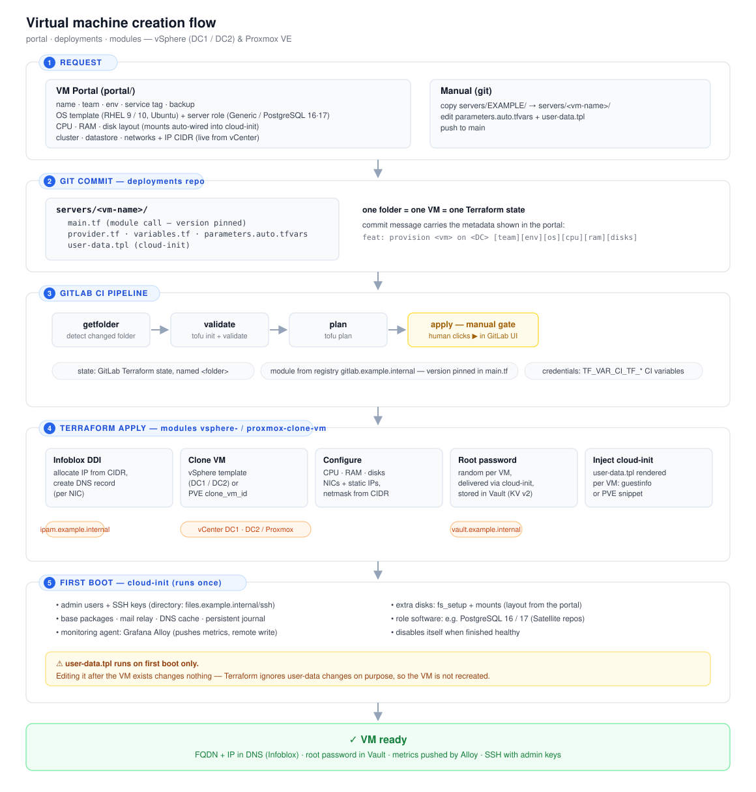

# vm-provisioning-platform

Self-service virtual machine provisioning for **VMware vSphere** and
**Proxmox VE**, built on GitOps: a web portal writes Terraform files into git,
a CI pipeline plans and applies them behind a manual approval gate, and
OpenTofu modules create the VM and wire it into IPAM, DNS, a password vault
(HashiCorp Vault / OpenBao) and configuration management; cloud-init installs
a Grafana Alloy agent that pushes metrics to any Prometheus-compatible backend. Decommissioning is the same
flow in reverse.



## Components

| Directory | What it is |
|---|---|
| [`portal/`](portal) | React + nginx self-service portal. Generates a server's Terraform folder and commits it through the GitLab API. Also lists, resizes and decommissions existing servers. |
| [`deployments/`](deployments) | One folder per server (= one VM = one Terraform state), plus the GitLab CI pipeline that validates, plans, applies (manual gate), post-configures, destroys and cleans up. |
| [`modules/`](modules) | OpenTofu/Terraform modules `vsphere-clone-vm` and `proxmox-clone-vm`: IP allocation + DNS, clone, sizing, root password (stored in Vault), cloud-init injection. |

## Lifecycle

```
create       portal ──commit──▶ servers/<vm>/ ──▶ validate ▶ plan ▶ apply (manual) ▶ postconfig
                                                     │
                                                     └─ module: IPAM/DNS ▶ clone ▶ password vault
                                                        cloud-init (first boot): users, monitoring agent, disks, role software

resize       portal edits parameters.auto.tfvars ──▶ same pipeline, in-place update

decommission portal: git mv servers/<vm> deleted/<vm> ──▶ destroy-plan ▶ destroy (manual) ▶ cleanup
                                                         cleanup: config mgmt, Terraform state
```

## Design notes

Some of the decisions that shaped this — mostly learned in production:

- **One folder = one VM = one state.** Small blast radius; a bad plan can only
  ever touch one server. The pipeline refuses pushes that touch several
  server folders, because the state name is derived from the folder.
- **Delete by `git mv`, never `git rm`.** Moving a folder to `deleted/` both
  triggers the destroy pipeline and keeps a permanent record of what the VM
  was. A plain delete fails the pipeline on purpose.
- **Manual gates on every apply and destroy.** The portal only commits; a human
  reads the plan.
- **Per-cluster credentials, no fallback.** Proxmox folders pin their cluster
  key; the pipeline selects that cluster's token and fails loudly when it is
  missing rather than authenticating against the wrong cluster.
- **Generated cloud-init is tested as YAML.** One stray newline in a pasted SSH
  key once made cloud-init load an *empty* config: the VM booted unconfigured
  while the pipeline reported success. Every OS × role combination is now
  rendered and parsed in CI.
- **Hard stop on destroy, SMBIOS overwritten on clone, `x86-64-v3` CPU** — each
  a Proxmox lesson, documented in [`modules/`](modules).
- **Secrets stay server-side** in the portal: nginx injects the GitLab and
  Proxmox tokens, scoped to the endpoints the portal needs.

## Getting started

1. Publish the modules to a module registry
   ([`modules/gitlab-ci.publish.yml`](modules/gitlab-ci.publish.yml) does this
   for GitLab).
2. Create a GitLab project from [`deployments/`](deployments), set the CI/CD
   variables listed in its README, and point the runner image at
   `gitlab-opentofu`.
3. Configure and run the portal: `cp portal/portal.env.example portal/portal.env`,
   then [`portal/deploy.sh`](portal/deploy.sh).

Everything organisation-specific — sites, networks, templates, admin users, CA
certificates, endpoints — is configuration; the values in this repository are
placeholders (`example.internal`, documentation IP ranges).

## Tests and CI

[`.github/workflows/ci.yml`](.github/workflows/ci.yml) runs on every push:

- **portal** — `npm test` (cloud-init rendering for every OS × role, SSH-key
  handling, OS detection, disk validation, full-app server-side render) and a
  production build
- **modules** — `tofu validate` through the example deployments that call them
- **scripts** — shell syntax check
- **secret scan** — gitleaks
- **denylist** — optional guard against organisation-specific terms; patterns
  come from the `DENYLIST` repository secret, never from the repo itself

## Security notes

The portal has no authentication of its own and the vSphere SOAP login runs in
the browser — see [`portal/README.md`](portal/README.md#security). Run it on a
trusted network or behind an SSO proxy, with a read-only vCenter account.

## License

[MIT](LICENSE)
